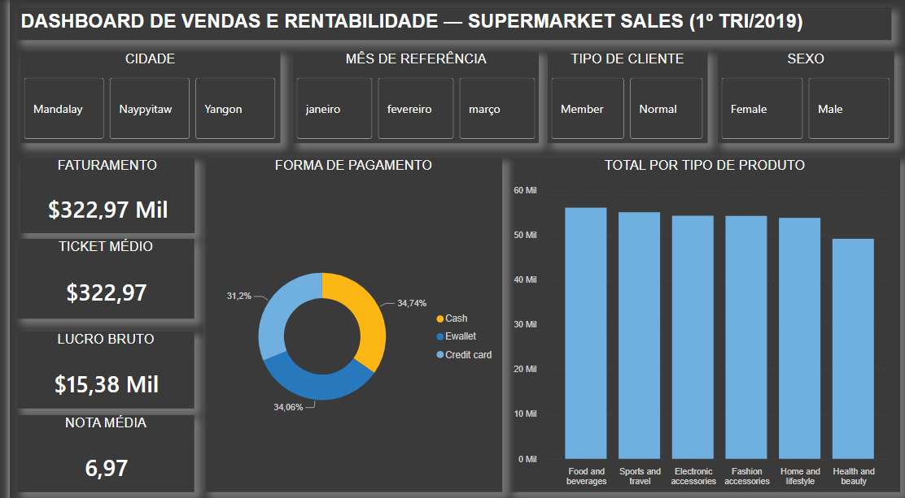
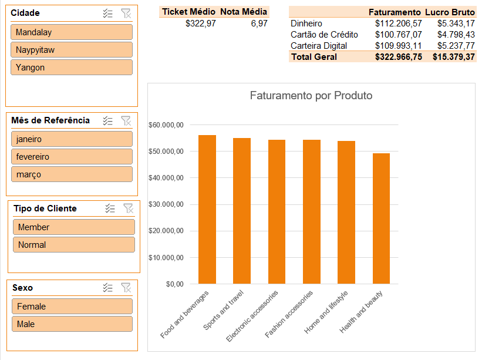
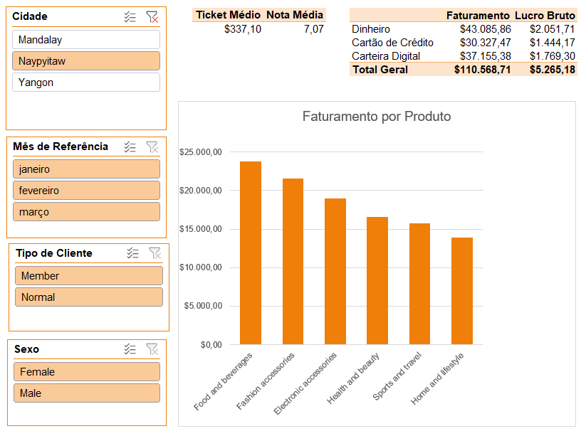

# 📊 Análise de Vendas e Rentabilidade — Rede de Supermercados (Excel & Power BI)

Projeto de análise exploratória, tratamento de dados e construção de dashboards interativos em **Microsoft Excel** e **Power BI**, utilizando a base pública *Supermarket Sales* (Kaggle). O objetivo do estudo foi avaliar o desempenho comercial de 3 filiais durante o 1º trimestre de 2019 sob uma ótica prática de gestão de varejo.

---

## 🎯 Perguntas de Negócio Respondidas

Para orientar a visualização e evitar sobrecarga de informações, os painéis foram projetados para responder aos seguintes pontos críticos da operação:

1. **Desempenho Financeiro:** Qual é o faturamento total, o ticket médio e o lucro bruto gerado por filial e por meio de pagamento?
2. **Qualidade da Venda:** O volume de faturamento está acompanhado de uma boa satisfação dos clientes (*Rating*)?
3. **Mix de Produtos:** Quais categorias impulsionam a receita em cada loja e como esse perfil de consumo varia conforme o público?
4. **Impacto dos Meios de Pagamento:** Qual é o peso das vendas no cartão de crédito em relação ao dinheiro e carteiras digitais (fator crítico devido às taxas financeiras das adquirentes)?

---

## 🖥️ Dashboards Interativos

O projeto foi desenvolvido em duas ferramentas para demonstrar domínio em diferentes ambientes de Business Intelligence, priorizando **limpeza visual, alinhamento e interatividade**.

### 1. Versão Power BI (Visão Executiva — Filtro: Mandalay)
Desenvolvido com tema escuro, cartões de KPI dinâmicos e **Segmentadores de Botão** no cabeçalho para filtragem rápida por unidade, período, tipo de cliente e gênero.


### 2. Versão Microsoft Excel (Visão Geral e Filtrada)
Construído com Tabelas Dinâmicas conectadas a Segmentações de Dados e **Proteção de Planilha** (travando edições acidentais e mantendo apenas os filtros clicáveis).

* **Visão Consolidada (Todas as Unidades):**


* **Exemplo de Filtragem Dinâmica (Unidade: Naypyitaw):**


---

## 🔍 Principais Insights e Descobertas

* **Equilíbrio entre Unidades:** O faturamento total do trimestre foi de **\$322.966,75** (com ticket médio de **\$322,97** e nota média de **6,97**). A filial de **Naypyitaw** liderou o faturamento acumulado (**\$110.568,71**), impulsionada pelo maior ticket médio (**\$337,10**) e pela melhor avaliação média (**7,07**).
* **Mudança no Mix por Cidade:** No consolidado geral, *Food and beverages* lidera as vendas. Porém, ao filtrar **Mandalay** (faturamento de **\$106,20 mil** e ticket médio de **\$319,87**), *Sports and travel* e *Health and beauty* assumem o topo, enquanto em **Naypyitaw** *Fashion accessories* ganha destaque na segunda posição.
* **Distribuição de Pagamentos:** As receitas estão bem equilibradas entre **Dinheiro**, **Carteira Digital (*Ewallet*)** e **Cartão de Crédito** (em Mandalay, por exemplo, o cartão representa **35,17%** das vendas), o que ajuda a diluir o impacto de taxas de intermediação financeira sobre o caixa.

---

## 🧠 Análise Crítica da Base de Dados (Engenharia & Negócio)

Durante a exploração dos dados, foram identificadas características estruturais importantes que diferenciam uma base acadêmica de um ambiente real de varejo:

### 1. Redundância de Colunas (Arquitetura de Dados)
Das 17 colunas originais da base, **5 colunas são puramente derivadas** a partir de apenas dois campos base (`Unit price` e `Quantity`):
* `cogs` = `Unit price × Quantity`
* `Tax 5%` = `(Unit price × Quantity) × 0,05`
* `Sales` = `cogs + Tax 5%`
* `gross income` = `Tax 5%`
* `gross margin percentage` = `100 - ((cogs / Sales) × 100)`

> **Nota Técnica:** Em bancos de dados produtivos de alto volume, armazenar colunas calculadas sem necessidade aumenta custos de armazenamento e risco de inconsistência, sendo mais eficiente calculá-las na camada de consulta ou visualização (SQL/DAX).

### 2. Limitações Contábeis da Base Sintética
Sob a ótica real de operação comercial, a base apresenta uma simplificação contábil: o campo `Unit price` atua como custo da mercadoria (`cogs`), e o lucro bruto (`gross income`) corresponde exatamente à alíquota fixa de 5%.
* Em uma operação real de supermercado, uma margem bruta de apenas 5% seria inviável após o desconto de taxas de cartão de crédito, impostos sobre faturamento e despesas fixas (aluguel, energia, folha de pagamento).
* Por esse motivo, manteve-se o rigor técnico de reportar **Lucro Bruto** e não **Lucro Líquido**.

---

## 🛠️ Ferramentas e Tratamento Aplicado

* **Microsoft Excel:** Limpeza de formatação (moeda, data, hora e percentuais), criação da coluna auxiliar de *Mês de Referência*, Tabelas Dinâmicas, Gráficos Dinâmicos, Segmentação de Dados e Proteção de Planilha.
* **Power BI Desktop:** Modelagem visual, uso de Hierarquia de Datas nativa, cartões de KPI, gráficos comparativos e Segmentadores de Botão.

---

## 📂 Estrutura do Repositório

```text
📁 analise-vendas-supermercado/
 ├── 📁 imagens/
 │    ├── dashboard_excel_geral.png      # Print da visão geral no Excel
 │    ├── dashboard_excel_filtro.png     # Print da visão filtrada no Excel
 │    └── dashboard_powerbi.png          # Print do dashboard no Power BI
 ├── 📄 SuperMarket Analysis.csv         # Base de dados original (Kaggle)
 ├── 📄 dashboard_supermarket.xlsx       # Planilha Excel interativa
 ├── 📄 dashboard_supermarket.pbix       # Projeto editável do Power BI
 ├── 📄 dashboard_powerbi.pdf             # Exportação em PDF do painel Power BI
 └── 📄 README.md                        # Documentação completa do projeto
```
